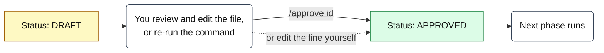
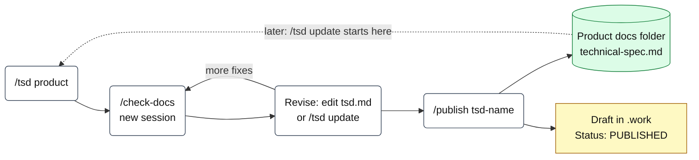

# Pipeline

How each phase works, why it is shaped this way, and what to do when it goes wrong. Daily commands are in the [README](../README.md). Which agent runs each command, and what it may do, is in [Customization](customization.md#agents).

```
/scope <idea>          (optional, before any work item exists) epic, features, stories   GATE: /approve scope-<name>
/slice scope-<name>    features and stories in build order, mapped to code              GATE: /approve scope-<name> milestones
/backlog scope-<name>  ADO import file (default), ADO items, or local items
/start <id> feature    fetch work item, create .work/<id>-<name>/, confirm repos, create branches
                       (add a repo folder or ADO connection as a 3rd argument for another collection)
/spec <id>             questions one at a time, then spec.md        GATE: /approve <id>
/plan <id>             files per repo, pattern to follow, test plan GATE: /approve <id>
/tasks <id>            small tasks, each with a verify command      skim task sizes
/do-task <id> <n>      one task per fresh session, TDD, commit      repeat
/review <id>           pass 1 spec, pass 2 quality                  accept findings as tasks
/pr <id>               short title and description per repo
You push (or approve the agent pushing) and open the PR. Your normal review and CI/CD take it to production.
```

## Design choices

Built for a slower model that needs explicit procedures.

| Choice | Why |
|---|---|
| Every command is a numbered list of steps | Weaker models follow procedures far better than goals. |
| Every command re-reads files from disk | Nothing has to be remembered across sessions. |
| Gates are a `Status:` line, set by `/approve` or by you | Approval is a fact on disk, not a judgment the model makes. |
| One task per fresh session | Context stays small. Long sessions are where weaker models drift. |
| Agents have narrow permissions | A planner that cannot edit code cannot start coding. |
| Stop after 3 failures | Prevents long loops that make things worse. |
| Verify output is pasted into `progress.md` | No "it should work now" without proof. |
| A template for every file | Filling blanks is more reliable than free-form writing. |

## Gates

A gate is the `Status:` line at the top of a file. Nothing moves past a gate until you approve it. Approve with a command, so you never have to edit the line by hand:

| File | Created by | Approve with | Checked by |
|---|---|---|---|
| `spec.md` | `/spec` | `/approve <id>` | `/plan` |
| `plan.md` | `/plan` | `/approve <id>` | `/tasks`, `/do-task` (feature lane) |
| `bug.md` | `/bug` | `/approve <id>` | `/do-task` (bug lane) |
| `tsd.md` | `/tsd` | `/publish tsd-<name>` (approves and moves it) | `/tsd` (refuses to overwrite an approved TSD) |



**`/approve <id> [spec|plan|bug]`** (planner)

- With no file named, it approves the first DRAFT in this order: `spec.md`, `plan.md`, `bug.md`. Name one to be explicit: `/approve 12345 plan`.
- It refuses a plan while the spec is still DRAFT, and refuses anything on a paused item.
- If "Open questions" still has items, it shows them and asks. Yes marks each one `(accepted risk)`; no stops so you can answer them first.
- It changes only the `Status:` line, logs to `progress.md`, and gives the next command (`/plan`, `/tasks`, or `/do-task <id> 1` in a new session).

Editing the line yourself still works; the next command reads whatever is on disk. Agents never set `APPROVED` in any other command. To send a draft back, leave it as DRAFT, add notes under "Open questions", and re-run the same command. It refines the draft instead of starting over.

## Lanes

| Lane | Use when | Flow |
|---|---|---|
| Feature | New behavior, or more than 3 files of change | Full pipeline |
| Bug | A defect with a reproducible symptom | `/start` → `/bug` → `/approve` → `/do-task` (repeat) → `/review` → `/pr` |
| Scope | The work is an idea, not work items yet | `/scope` → `/approve` → `/slice` → `/approve` → `/backlog`. Then each story runs the feature lane. See [Scoping](#scoping-before-work-items). |
| Spike | You do not know enough to write a spec | `/spike` writes `findings.md`. No code changes. Good input to a later `/spec`. |
| Docs | Writing or updating documentation | `/docs` (writer) → new session → `/check-docs` (reviewer fact-checks every claim) |
| TSD | A technical spec of a product or repos, told through diagrams | `/tsd` (writer) → new session → `/check-docs` (reviewer checks every box and arrow) → revise → `/publish tsd-<name>` (approves it and moves it to the product docs folder) |

Bug lane rules:

- `/bug` writes `bug.md` (symptom, code path, root cause with confidence) and a `tasks.md` with **at most 3 tasks**.
- Task 1 is always a test that fails because of the bug.
- If root-cause confidence is Low, `/bug` stops and points you to `/spike`.
- If the fix needs more than 3 tasks, it moves to the feature lane (`/spec`).

## Scoping (before work items)

Use this when you have an idea ("add a change request ticket type") and no work items yet. It ends with work items that `/start` can take, one per story.

| Level | What it is | ADO type |
|---|---|---|
| Epic | A version of the product, for example "Tickets v2.1" | Epic |
| Feature | The smallest piece a user can use on its own | Feature |
| Story | A piece of a feature; one `/start` run | User Story (`-StoryType` for Scrum's Product Backlog Item) |

| Step | Agent | What happens |
|---|---|---|
| `/scope <idea>` | product-manager | Reads the repo map, product docs, repo guides, and the code for what exists, and `git log` for recent changes. Asks at most 3 questions, one at a time (one is the epic if you did not name it). Writes `epics.md` (MVP features and Icebox) and `stories.md` (Gherkin acceptance criteria). |
| `/approve scope-<name>` | planner | Approves `stories.md`, and `epics.md` with it. |
| `/slice scope-<name>` | milestone-architect | Maps each story to real files (as local notes for the builder), makes every feature a vertical slice, sizes each story for one `/start` run, puts schema and setup work first, orders everything, writes a short description and release note per feature, and writes `milestones.md`. Lists every change it made to the stories. Runs `Export-Backlog.ps1 -Check` on the result. |
| `/approve scope-<name> milestones` | planner | Approves `milestones.md`. |
| `/backlog scope-<name> [csv\|ado\|local]` | milestone-architect | `csv` (default): `backlog.csv` for ADO's Import Work Items, as an Epic, Feature, story tree. `ado`: a dry run, your yes, then creates the items with parent links. `local`: one `L<number>` item per story. `ado` and `local` record ids in `published.md`, so a failed run continues where it stopped. |
| `/triage <ADO id> [note]` or `/triage <words>` | investigator | Before any work: fetches the item and its comments (`Get-WorkItem.ps1` into `.work/triage-<id>/`), reads the repo map, guides and code, and writes `triage.md`: summary, products and repos, related items, questions for the requester, `Route:` (delegate, myself, undecided) and `Size:`. A note after the id (who asked, why) goes in `note.md` and counts as part of the request. Run it again after the requester answers (comments, or `answers.md` in the folder). Never posts. |
| `/shape <idea>` | product-manager | Interviews you about an idea, one round per run, never in the chat: up to 5 questions with options and a recommendation in `.work/shape-<name>/questions.md`, a running `understanding.md` (your edits win), your answers in `answers.md`. When the problem, users, goals, MVP line and key rules are known (or `/shape shape-<name> brief`), writes `brief.md` with a Level and Size. `/shape triage-<name>` starts from a triage. `/shape shape-<name> more` asks another round. Then `/scope shape-<name>` or `/refine shape-<name>`, which ask only what the brief leaves open. |
| `/refine <title>` | product-manager | One story or bug: asks at most 2 questions, writes `.work/refine-<name>/refine.md` (Description, Gherkin Acceptance criteria, Notes for the builder). Gate: `/approve refine-<name>`. `/refine refine-<name>` revises a draft. |
| `/handoff <id> <name>` | writer | A brief for the person the work is delegated to, in `.work/handoff-<id>/handoff.md`. Posts nothing. |

Then run `/start <story id> feature` for each story, top to bottom. ADO gets only what product needs: a feature's two or three sentence description and its release note (in the field named by `releaseNoteField` in `config.json`), and a story's "As a ..." line, short context and 2 to 5 acceptance scenarios. Each story's "Notes for the builder" (where to look, similar code, dependencies) stay in `milestones.md`; `/spec` finds them through `published.md` and treats them as hints, so engineering still decides the implementation.

- To refine a draft, edit the file or add notes under "Open questions", then re-run `/scope scope-<name>` or `/slice scope-<name>`.
- To use an epic that already exists in ADO, answer the epic question with its id. `milestones.md` gets `Epic: #<id> <title>`. `ado` links the features to it; the CSV leaves the epic out and you link the features after the import.
- The scope folder shows on the dashboard with its next step.

## Technical specs (/tsd)

`/tsd <product>` documents a whole product from the repo map's Products block. `/tsd <repo> [repo ...]` documents named repos and offers to add the other repos in the same product.

| Step | What happens |
|---|---|
| Scope | Repos from the product block. You confirm the list. |
| Inventory | `inventory.md`: deployables, DbContexts and entities, external systems, entry points, background jobs, auth, status fields, deployment files. Every row cites a file. Config files are never opened; key names come from code. |
| Picks | It proposes flows and business processes. You pick 3 to 5 flows and 1 to 3 processes. It traces each through the code. |
| Write | `tsd.md` from the template. Each diagram copies a pattern from `templates/tsd-diagrams.md`. |
| Check | `Test-Mermaid.ps1` renders every block with mermaid-cli and reports the failing ones with the file line. Without mermaid-cli it runs static checks and the agent works through a checklist. |
| Fact-check | New session, `/check-docs .work/tsd-<name>/tsd.md`. Every box, arrow, entity, and column is checked against the code. |
| Revise | Edit `tsd.md` yourself or re-run `/tsd` (update). |
| Publish | `/publish tsd-<name>` is your approval. It warns if there is no fact-check or the check found errors, copies the TSD to the product's "Product docs" folder from the repo map (or a folder you name) as `technical-spec.md`, drops the agent comments, stamps `Approved: <date>`, and marks the `.work` copy `PUBLISHED`. You commit it. |



The `.work` copy is the draft; the published copy is the live one. A later `/tsd` update starts from the published copy, so edits you make there are kept.

**`/publish <folder>`** (writer) is generic: it handles any `.work` folder that holds a publishable document. Today that is `tsd.md`. To add another kind (for example spike findings), add a row to the table in `core/commands/publish.md` with its default destination and file name.

| Diagram | Mermaid type | Drawn from |
|---|---|---|
| System context | `flowchart` | Product block, external calls in code |
| Containers | `flowchart` with a subgraph per repo | Deployable projects, DbContexts, queues, HTTP clients |
| Database schema | `erDiagram`, one per DbContext | Migrations `*ModelSnapshot.cs`, else entity configs |
| Key flows | `sequenceDiagram` | Code path traced from the entry point |
| Business processes | BPMN-style `flowchart` (lanes, events, gateways) | Status fields, handlers, product block, product docs |
| Deployment | `flowchart` | Pipeline YAML, Dockerfile, IaC files |

Only `flowchart`, `sequenceDiagram`, and `erDiagram` are used, because doc editors often bundle an older Mermaid. Mermaid has no BPMN diagram, so processes use BPMN shapes and colors in a flowchart; the legend is in the TSD.

Better input gives better diagrams: fill in "External systems" and "Business processes" in each product block of the repo map, and link the product docs.

## Phase notes

**/start**
- A script creates the folder name and slug, so branch names are consistent: `dev/<lane>/<id>-<short-name>`.
- With several ADO collections, the script picks the connection from the optional third argument (a connection name or a repo folder), a `paths` mapping, the repo's `origin` URL, or `default`. If it cannot tell, the planner asks you. `workitem.md` records which connection it came from. Setup: [Connect to ADO](onboarding-company.md#3-connect-to-ado).
- If ADO is unreachable, offline mode creates the folder from a title you paste; then you paste the details into `workitem.md`.
- Proposes repos from the repo map and asks you to confirm.
- Never switches a repo with uncommitted changes (skips it). Asks before switching a repo that is on another item's `dev/` branch.
- Ends with a warm start: it writes `brief.md`, a two-minute read with the goal, the acceptance criteria as a checklist, the parent Feature and Epic, the last 5 comments, the repos and branch, up to 10 likely files, and the first tiny step. It prints the brief before the next command.
- The likely files are guesses from file names and commit messages that match words in the title. `/start` opens no files to find them, so it stays fast.
- `-Parents` on `Get-WorkItem.ps1` adds the parent Feature and Epic to `workitem.md`. If they cannot be fetched, the brief says "Parents unknown".
- `/start <id> <lane> --cold` skips the brief.

**/spec**
- Questions come one at a time with options and a recommendation, so you can reply "A" or "yes".
- At most 6 questions. If the item needs more, consider splitting it in ADO.

**/plan**
- Each repo section names a "pattern to follow": a real file that does something similar. This is the most effective way to get consistent code from a weaker model.
- The test plan maps every acceptance criterion to a test before any code exists.

**/tasks**
- Each task touches one repo and at most 3 files (or your configured cap). Split big-looking tasks by hand before starting.
- A coverage table proves every acceptance criterion has a task.
- Every task has a "Human interface" line (page, button, endpoint, or command) so the implementer knows how a person meets the code.

**/do-task**
- Always in a new session. Checks the gate, the branch, and that the repo has no unrelated changes.
- .NET is strict TDD: both the failing and the passing run go in `progress.md`. If the "failing" run passed, the test does not test the change.
- Stages only the task's files and commits with a short summary. You approve the commit.
- Ends with a Manual Validation Checklist: exact URL, exact click or command, exact result. It is saved in `progress.md`, and `/review` blocks on a missing or vague one and collects them all into `review.md`.

**/review**
- Runs every repo's unit tests, then reads the diff against `origin/main`.
- Pass 1 (spec) and pass 2 (quality) are separate, so spec checks are not skipped in favor of style comments.
- Verdict is `READY` only if tests pass, every criterion is `Met`, and there are no Blockers. Findings you accept are appended to `tasks.md`.
- `/review <id> auto` (used by autopilot) asks nothing: it turns every Blocker into a fix task and stops.

**/pr**
- Title under 70 characters, one or two sentences, up to 4 bullets, a testing line, the work item link.
- Pushes only if you tell it to, with an approval prompt for each push. You open the PR.

## Work files

All state lives in the workspace, outside every git repo, and never leaves the work PC.

```
.work/<id>-<short-name>/
  workitem.md   brief.md   repos.md  spec.md   plan.md       tasks.md
  progress.md   review.md  pr.md     bug.md    findings.md   paused.md

.work/scope-<short-name>/                scoping: epics.md, stories.md, milestones.md, progress.md,
                                         backlog.csv or published.md
.work/spike-<short-name>/findings.md     spike without a work item
.work/pr-<pr id>/                        first-pass PR review: context.md, threads.md, review.md (drafts), history/
.work/docs-<short-name>/sources.md       docs lane: claims and their source files
.work/docs-<short-name>/check.md         docs lane: fact-check results
.work/tsd-<short-name>/                  TSD draft: inventory.md (facts), tsd.md, sources.md, check.md,
                                         render/ (one SVG per diagram). /publish copies tsd.md out.
.work/_onboard/<repo>-AGENTS.md          onboard draft when the repo already has a repo guide
                                         (<repo>-AGENTS.local.md when the team committed its own AGENTS.md)
.work/runway.md                          end-of-day note from /shutdown; overwritten daily
.work/dashboard.html                     the static dashboard (/dashboard static); never edit
.work/_dashboard/                        Dispatch (Workshop's opencode connector): sessions.json (item to session
                                         links), autopilot.json, projects.json, pr-queue.json; never edit
```

`<short-name>` is the first 5 words of the work item title, lowercase, filler words dropped, at most 40 characters.

## Reviewing teammates' PRs

`/pr-review <PR link>` (agent: **pr-reviewer**) does a first pass on someone else's Azure DevOps pull request, so your own review starts from a short list instead of a blank diff. Dispatch has the same thing under **PR reviews**, with your review queue next to it.

1. `scripts/ado/Get-PullRequest.ps1` reads the PR, its linked work items, and its comment threads (GET calls only), finds the repo among your workspace folders, and fetches the PR's branches into private refs (`refs/eng-agents/pr/<id>/source` and `/target`). Nothing is checked out: your working tree and branches stay as they are. A PR from a fork is read from ADO's merge ref.
2. The agent reads the diff and, where it needs more, whole files at the PR's commit with `git show`, plus your repo guide. Pass 1 checks the linked acceptance criteria; pass 2 looks for real problems (correctness, security, contracts, error handling, data, patterns, tests, build, leftovers). It skips anything already raised on the PR.
3. It writes `.work/pr-<id>/review.md`: a recommendation, a risk level, and numbered draft comments (file, line, severity `blocking` / `should-fix` / `optional`, why, and the comment as you would post it).

**It never posts.** No comments, votes, approvals, or rejections. The agent cannot check out, fetch, push, or make web requests. You read the drafts, edit them, and post the ones you agree with.

Running it again after the author pushes refreshes `context.md` and `threads.md` and moves the old review to `history/`. On the same commit it stops and says so; add `again` to review it anyway.

The PAT needs **Code (Read)** and **Work Items (Read)**. The repo must be cloned in the workspace; if it is not, the command names the repo and its clone URL.

## Prepping a 1:1

`/one-on-one <path to packet.md>` (agent: **people-prep**) drafts talking points for a 1:1 with someone on your team. You normally run it from the 1:1s tab in Workshop's Rapport (**Draft talking points**), which writes the packet and reads the draft back.

1. Rapport gathers what Docket, its own receipts and notes, and Slate (work delegated to the person) know about the person since your last 1:1 and saves it as `packet.md` in Workshop's own folder (`~/.workshop/data/_connectors/opencode/oneonones/<person>-<date>/`). It leaves out the person's name, and concerns from receipts unless you ask for them on that run. Nothing goes in the workspace or `.work`.
2. The agent reads only that file and writes `draft.md` next to it from `templates/one-on-one.md`: wins to recognize, follow-ups from last time, blockers to ask about, growth topics, and 3 questions to ask.

**It drafts only.** It never rates, ranks or judges the person, and it never adds facts that are not in the packet. It can edit nothing but that `draft.md`, runs no shell commands except listing the packet's folder, and makes no web requests.

## The hub

`/hub <path to request.md>` (agent: **hub**) handles one message typed into the hub on Workshop's Dispatch page. You normally never type it: Dispatch writes the request and reads the result.

1. Dispatch saves your message, with today's date, your people directory (people and groups, with ids and @handles) and your Docket list names and your team's ADO area paths (the `Team areas` section), as `request.md` in Workshop's own folder (`~/.workshop/data/_connectors/opencode/hub/<id>/`). Nothing goes in the workspace or `.work`.
2. The agent writes `route.json` next to it: captures (Docket tasks, receipts, notes) that you accept in Dispatch, with people and groups named by their directory ids, a question, an app to open, a suggested action, or a clarifying question such as which product you mean.
3. For a question it goes on to answer. It finds the product in the repo map (Products, "Also called", Glossary), reads that repo's guide, confirms in the code, and writes `answer.md`: the answer first, then Confirmed lines with file and line, Suspected lines, and a confidence. "Where was I" questions read `.work/runway.md` and the item's files.

**It changes nothing.** It can write only those two files, runs only read-only commands, makes no web requests, and never assigns, creates or changes anything in Azure DevOps or git. A suggested action (for example a spike) is a button you click in Dispatch, with its own confirm. The session shows in Dispatch, so you can follow it or reply.

The repo map is what makes "what version of .NET is the portal on" work: keep each product's "Also called" names and the Glossary current.

## Shared repos

- Consumers reference shared code by relative path, so one flat clone in the workspace satisfies all of them. Duplicate clones drift apart.
- The repo map records which repos depend on each shared repo. `repos.md`, the plan, and tasks put shared repos first.
- `/review` runs tests in every repo in `repos.md`. Add any other consumer that could break so its tests run too.
- If a shared repo is consumed as a published package instead, the plan needs a version bump task. Note that in the repo map.
- Need a shared repo on two branches at once? Add a worktree instead of a second clone, and remove it after the PR merges. Relative-path consumers still point at the main clone.

  ```powershell
  git -C C:\src\work\<shared-repo> worktree add ..\<shared-repo>-12345 dev/feature/12345-short-name
  git -C C:\src\work\<shared-repo> worktree remove ..\<shared-repo>-12345
  ```

## End of day

`/shutdown` (planner) offloads your head before you log off.

- Reads `git status` and `git diff` in every repo and the last `progress.md` entry of every item, without narrating.
- Asks one question: the first thing tomorrow, and anything else lingering.
- Writes `.work/runway.md` (overwritten daily): **Current State** (two sentences), **Tomorrow's Ignition** (the smallest first step, usually an exact command), **Open Loops** (your brain dump, plus loops from yesterday you did not drop, plus any blocked task), and a snapshot of repos and items.
- Commits, stashes, and pushes nothing. If a repo has uncommitted work it says so and points to `/pause <id>` for a WIP commit.

Next morning, `/status` with no id starts with the runway.

## Pausing and resuming

`/pause <id> [reason]` when you drop an item for a while.

- Writes `paused.md`: phase, tasks done, the task in progress and what is left of it, what it is waiting on, and the next command.
- For uncommitted changes it asks one question: commit as `WIP <id>: ...` (frees the repo) or leave them. Nothing is stashed or discarded.
- While paused, agents refuse other pipeline commands on the item except `/status` and `/resume`.

`/resume <id>` first prints the brief (if the item has one) and the last `progress.md` entry. Then it switches each repo back to the item's branch (asking first if a repo is on another item's branch), warns if `main` has moved, marks `paused.md` as `RESUMED`, and gives the next command. A half-done task continues from the "Work in progress" notes. Squash WIP commits when merging if your team prefers clean history.

## Dashboard

Dispatch, the Agents app in [Workshop](https://github.com/adavidson21/workshop), is the live UI for this pipeline: every item in `.work`, where it stands, the agents working on it, and one button per step. It runs in Workshop on your computer, through Workshop's opencode connector, and replaced the live dashboard that used to run from eng-agents (Core 2.11.0). To set it up, see Dispatch in Workshop's README.

- `/dashboard` opens Dispatch in your browser. `/dashboard <id>` opens it at that item.
- It starts nothing. If Workshop is not running, it says so (start it with `workshop up`, or Workshop in the Start menu) and stops.
- `/dashboard static` builds the [static page](#static-page) instead. It needs only PowerShell and git, for terminal-only use.
- `/status [id]` answers the same question in the terminal.

Where `/dashboard` opens Dispatch: the site Workshop names itself (its `GET /api/health` answer since agent 1.5.0, else the first https site in its `config.json`), or Workshop on this computer (`http://127.0.0.1:<port>/`, port from Workshop's `config.json`) when Workshop is in work mode. Tandem names no website itself. To use another address, set Workshop's address in `config.json`:

```json
{
  "dispatch": { "url": "https://workshop.example.com" }
}
```

Dispatch keeps its own state next to `.work`: `.work\_dashboard\` (item to session links, autopilot, projects, the PR review queue). What Dispatch does, and the full list of its actions, is in Workshop's `connectors/opencode/README.md`.

### Static page

`/dashboard static` writes `.work\dashboard.html`, a read-only summary of the files above plus the git state of every repo in the workspace, for picking up where you left off, and opens it.

| Part of the page | What it shows |
|---|---|
| Pick up here | The most recently touched item that is not paused: where it is on the track, the exact next command, and what the last session did. |
| Track | The pipeline stages for the item's lane. Finished stages have a check mark. The current stage is a filled label in the item's color (blue moving, amber needs you, red blocked, gray paused) with what is happening under it, for example "2 of 5 done" or "Approve". Later stages are faint, on a dashed line. Hover a stage for details. |
| Needs you | Items waiting on you: a `DRAFT` spec, plan, or bug to review and `/approve`, review findings to accept, or a `/do-task` that failed or was blocked. |
| In progress, Paused, Ready to ship | Every other item, grouped. Each card shows the next command, where you left off (the last `progress.md` entry, or `paused.md` when paused), its repos, tasks, files, and resume commands. |
| Pull requests | On Ready to ship items: the PR text from `pr.md` for each repo, with Copy title and Copy description, a **Create PR in ADO** button that opens the new PR page with the branches filled in, and, when the branch is not pushed yet, its push command with a copy button. |
| Spikes, docs, and TSDs | `spike-`, `docs-`, and `tsd-` folders with their state and next step (for a TSD: fact-check, fix, or `/publish`). |
| Repos with work in progress | Repos that are off their default branch or have uncommitted or unpushed work, and which item owns each branch. Clean repos are listed in one line. |
| Recent activity | One line per item per day, newest first, summing up what moved (for example "Did 3 tasks, reviewed, wrote PR text"). A red dot means a verify step failed that day. |

Links are built locally, with no network calls and no PAT:

- **Work item:** the `Link:` line in `workitem.md` (written by `/start`). For older or offline items, it falls back to the `ADO:` line plus `config.json`, then a repo's git remote.
- **Branch and Create PR:** from each repo's `origin` remote and the branch in `repos.md`. Works for ADO Server and GitHub remotes.

The page is a snapshot: it changes only when you build it again. The header says when it was built and turns amber after 3 hours. A bar at the top links to Dispatch for the live view.

**After a restart**, open `.work\dashboard.html` (bookmark it) to see where everything stood, or run `/dashboard` to open Dispatch. Without opencode, rebuild the static page from any terminal in the workspace root:

```powershell
cd C:\src\work
powershell -NoProfile -ExecutionPolicy Bypass -File "$env:USERPROFILE\.config\opencode\eng-agents\scripts\dashboard\New-Dashboard.ps1"
```

Use `pwsh` instead of `powershell` if you installed from PowerShell 7, and your `-Target` folder if you installed somewhere else. The page also has a "Copy shell command" button with the exact path. Each card's resume commands (`cd`, `opencode`, next command) are what to paste into a new terminal.

Options: `-NoOpen` writes the file without opening a browser, `-OutFile <path>` writes it somewhere else, `-Recent <n>` changes how many progress entries Recent activity draws from (default 80), `-AsJson` prints the data as one line of JSON instead of writing the page.

The next-command logic matches `/status`. If you change the rules in `commands/status.md`, change `Get-NextStep` in `scripts/dashboard/New-Dashboard.ps1` to match. Workshop's opencode connector reads `.work` with a copy of `New-Dashboard.ps1 -AsJson`, so Dispatch follows the same rules; change it here first, and Workshop syncs its copy.

### Themes

The static dashboard keeps its own copy of the themes in `dashboard.template.html` (between `themes:begin` and `themes:end`). Edit the block by hand if you change it, and bump Core's version.

### Autopilot

Autopilot runs the build half of an item for you, so your only stops are approving the plan and opening the PR. It runs in Dispatch (Workshop's opencode connector), which sends each step below to opencode.

| Button | Shows when | What it does |
|---|---|---|
| **Approve and build** | `plan.md` or `bug.md` is waiting for approval | Runs `/approve <id> plan` (or `bug`), then everything below. Clicking it is your approval. |
| **Build with autopilot** | The plan or bug analysis is already approved | Runs everything below from wherever the item is. |
| **Stop after this step** | Autopilot is running | The current step finishes. Nothing runs after it. |
| **Resume** | Autopilot is waiting for you | Re-reads `.work` and runs the next step. |

Each step runs in a **new session**, so every step starts with a clear context:

```
/tasks <id>                 feature lane only (the bug lane already has tasks from /bug)
/do-task <id> <n>           once per open task, in order
/review <id> auto           Blocker findings become fix tasks without asking, then back to /do-task
/pr <id>                    PR text in pr.md, then autopilot finishes. It never pushes.
```

The next step comes from the same rules as the "Next" line, read fresh from disk after every step. Commits happen inside `/do-task` as usual.

Autopilot **waits for you** (the item turns amber and moves to "Needs you") when:

- A step ends without moving the item forward, for example the agent asked you something in its reply instead of finishing. **Reply to the agent** and autopilot carries on when that turn ends, or fix it yourself and click **Resume**.
- A task is blocked (verify failed 3 times), a step fails, or you press **Stop** on the agent.
- The review is still not READY after **2 fix rounds**. The third review runs without `auto`, so it asks you which findings to fix.
- The item is paused.

Permission prompts and agent questions do **not** stop autopilot. The step waits for your answer in Dispatch, then continues.

While autopilot runs an item, that item's Run buttons are off, so two agents never work on it at once.

State is kept in `.work\_dashboard\autopilot.json`. If Workshop restarts mid-run, the item says so. Click **Resume**.

## Repo guides, team guides, and memory

Agents learn a repo from three places, read in this order:

| Source | Where | Written by |
|---|---|---|
| Repo guide | `<repo>\AGENTS.local.md` if it exists, otherwise `<repo>\AGENTS.md`. Never committed. | `/onboard-repo`, then you |
| Team guides | Committed `CLAUDE.md` and similar files listed in the repo guide's "Team guides" table | Your team |
| Repo memory | The repo guide's `## Remembered` section | `/memory <rule>` |

Plus **global memory** in `%USERPROFILE%\.config\eng-agents\memory.md` (`/memory -global <rule>`), loaded in every session. The repo guide wins over a team guide, and repo memory wins over global memory.

**Product notes** hold what the code cannot tell agents about a product (business rules, gotchas, who to ask, decisions): one note per product in Workshop's Notes app, `<Workshop data folder>/notes/products/<product>.md`. Agents read the note of each product the work touches (`scripts/notes/Get-ProductNote.ps1`) and add facts they confirm (`scripts/notes/Set-ProductNote.ps1`: one line at a time, with its date and source, keeping the earlier version in Notes' History). Notes marks a note **Changed by Tandem** until you click **Mark reviewed**. A fact that would still be true if the code were rewritten goes in the product note; a fact about one codebase stays in that repo guide. `/memory -product <product> <fact>` saves one yourself, `/onboard-repo` starts a missing note, and `/product-notes move` moves product facts out of repo guides. Without Workshop, or with Notes switched off, agents skip product notes.

- `/memory <rule>` uses the repo you are working in, or asks. `/memory <repo> <rule>` names it. `/memory -list` shows everything saved.
- It checks for a duplicate or contradicting line first, and offers to fix a wrong command or path in the repo guide instead of adding a memory line.
- Run it in the session where the rule came up, so "remember that" can be resolved to the real thing.
- Edit or delete memory lines by hand any time. Re-running `/onboard-repo` keeps the `## Remembered` section.

## Recovering from problems

| Situation | What to do |
|---|---|
| A session went off the rails | Close it, start a new one, run `/status <id>`. State is on disk. |
| Autopilot keeps stopping on the same task | Read the agent's last reply and the blocked entry in `progress.md`. Split the task or fix the plan, then click **Resume**. |
| Lost your terminals (restart, crash) | Open `.work\dashboard.html` to see where you were, or start Workshop and run `/dashboard` to open Dispatch: each item reopens its session. |
| A task is marked done but is wrong | Uncheck it in `tasks.md`, revert the commit yourself if needed (`git -C <repo> revert <sha>`), re-run `/do-task`. |
| A task keeps failing | Read the blocked entry in `progress.md`. Usually the task is too big or the pattern file is wrong. Split the task or fix the plan. |
| The plan was wrong after tasks started | Edit `plan.md` and `tasks.md` by hand. Add new tasks at the end; do not renumber finished ones. |
| Work item scope changed | Update `workitem.md`, set `spec.md` back to DRAFT, re-run `/spec`, then re-plan. |
| Abandon an item | In Dispatch, click **Abandon** on its card. Otherwise delete its `.work` folder yourself. Delete its branches yourself either way. |

## Tuning when the model struggles

| Symptom | Fix |
|---|---|
| Task fails or wanders | Split it into smaller tasks. |
| Ignores a convention | `/memory <rule>` saves it to that repo's guide; `/memory -global <rule>` saves it for every repo. Rules said in chat do not carry over. |
| Claims done without proof | Verify output must be in `progress.md`. Re-run `/do-task` and point at the missing evidence. |
| Asks too many questions | Answer them in `spec.md` directly, then re-run the next command. |
| Plans touch the wrong repo or order | Fix the repo map. |
| A TSD diagram keeps failing to render | Fix the block by hand using "Common errors" in `templates/tsd-diagrams.md`, then run `Test-Mermaid.ps1` yourself. |
| A TSD draws things that do not exist | Check `inventory.md` for the bad row and its source. Fix or delete it, then re-run `/tsd` and choose update. |

## Scripting with `opencode run`

Use the interactive window for real work. In testing, `opencode run "/spec 12345"` did not always expand the slash command (the model had to find the command file itself), and the question tool was unavailable, so questions came back as plain text.
