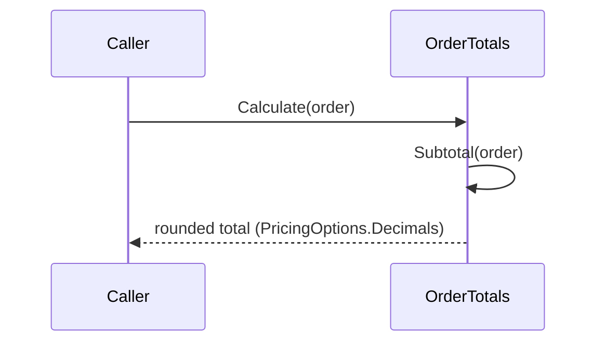

# Technical spec: sample-api

## Overview

An order pricing library: `OrderTotals.Calculate` turns an order into what the customer pays, with values that change kept in `PricingOptions`.

## Key flows

### Flow 1: Price an order

## Open questions

None.
